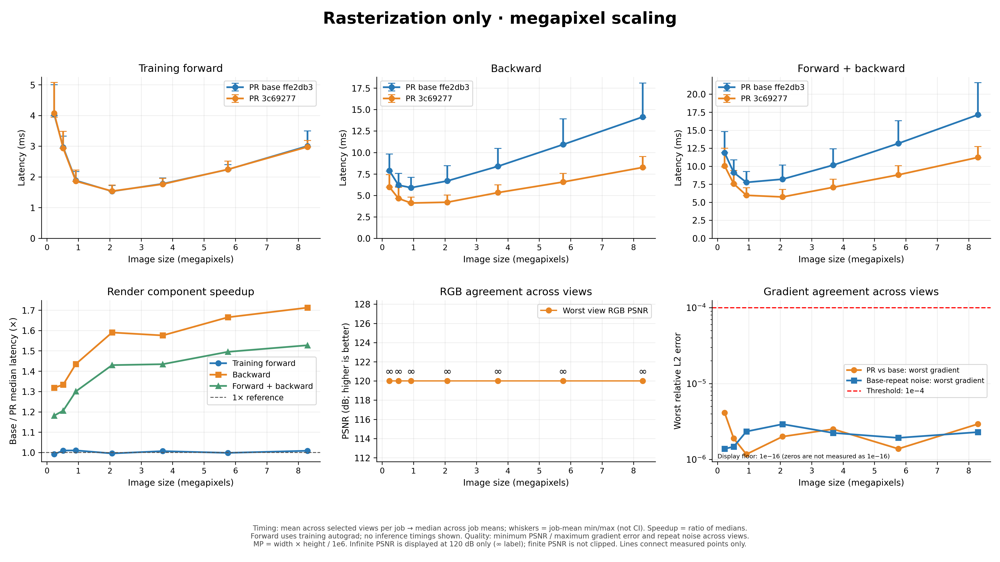
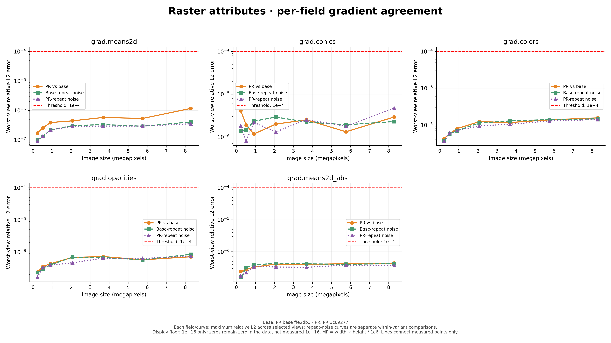
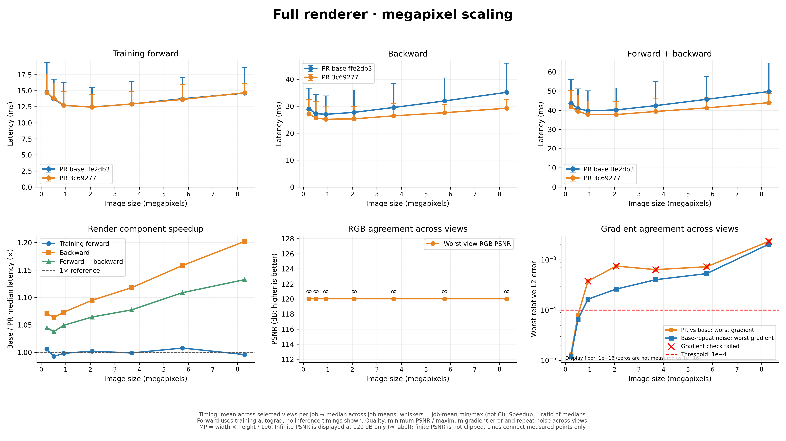
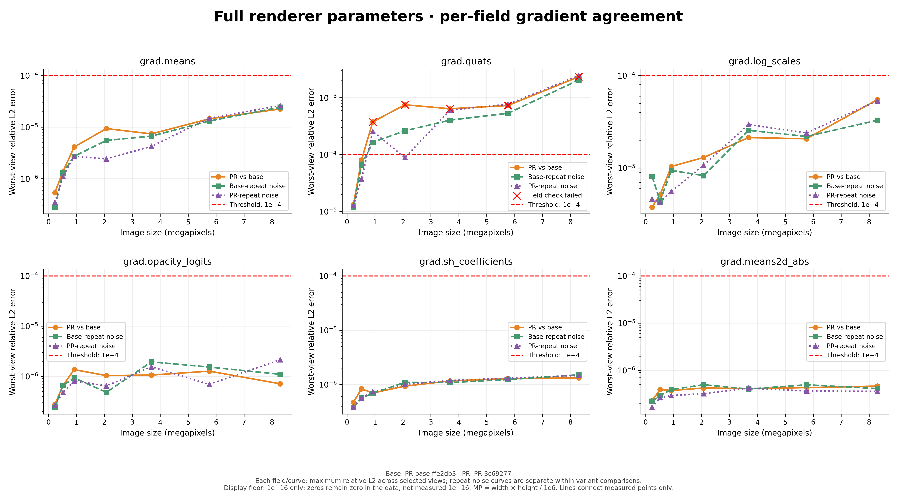
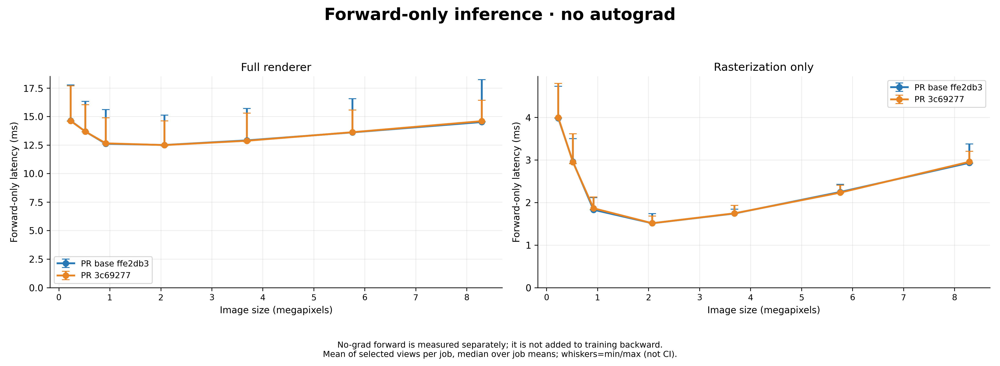

# PR #9: megapixel-scaling benchmark and numerical parity

This study compares **PR base `ffe2db3`** against the **PR #9 CUDA implementation
at `3c69277`**, as selected by the user. It does not compare literal upstream
`main`. The plotting style follows PR #3, but the workload is the user's real
20,789,814-Gaussian scene, not PR #3's synthetic 120k-Gaussian benchmark.

## Fixed workload and timing protocol

- RTX 4090 / SM89; provided Python environment, PyTorch 2.10.0+cu128 / CUDA 12.8.
- Full degree-1 SH PLY, no point subsampling; real cameras 0, 2552 and 5103.
- Resolutions: 640×360, 960×540, 1280×720, 1920×1080, 2560×1440,
  3200×1800 and 3840×2160 (0.2304–8.2944 MP).
- Camera extrinsics stay fixed. Intrinsics scale by width/native-width and
  height/native-height, preserving the horizontal and vertical field of view.
- Same float32 inputs, raw-parameter activations, compact-box=true/sweep,
  tile16, packed=false, RGB+ED and absgrad=true for both binaries.
- **Full** includes scale/opacity/quaternion transforms, projection, SH,
  binning/sorting, rasterization and backward. **Raster** uses detached projected
  attributes and precomputed intersection lists, and includes expected-depth
  normalization and its backward—not a bare single CUDA-kernel measurement.
- Each job uses 15 warmups and 30 measured iterations for no-grad forward and
  for differentiable forward+backward. Three independent jobs per binary run
  serially: base/PR, PR/base, base/PR. No concurrent task-owned GPU workloads.
- Training forward, backward and combined share CUDA events A/B/C in the same
  pass, with no synchronization between components. Event C is synchronized.
  No-grad forward is separately measured and is not added to training backward.
- Loading, compilation, gradient reference compression/comparison, loss and
  optimizer are excluded from the timed render windows. The GPU is also a
  desktop display device; job variation is retained, not presented as a CI.

## Forward and gradient checks

At every resolution/camera/scope in job 1, compare the same fixed, nonuniform
upstream image and alpha gradients. The seed depends on camera and resolution,
not worker order. Check all input-gradient entries and screen absolute gradients:

- Forward max-absolute error gate: **2e-5**, including depth and alpha.
- Gradient relative-L2 gate: **1e-4** per tensor, with absolute errors also saved.
- Baseline-versus-baseline and PR-versus-PR repeat noise are separate diagnostics,
  not waivers of failed comparisons. No fixed-repeat averaging is used here.
- Gradient references omit only exactly-zero Gaussian rows, losslessly; newly
  nonzero candidate rows outside the reference are included in the error norm.
- RGB PSNR excludes ED depth and uses fixed data_range=1. Exact RGB means +∞;
  a 120-dB plotting cap is only for display, never a measured finite PSNR.

The raster-only input reconstruction uses **unclamped SH + 0.5**, exactly like
`gsplat/rendering.py`. The setup is cross-checked against the full-render forward
image and alpha. An initial attempt had an extra raster color clamp and was
discarded; no timings or parity values from it are pooled into these results.

## Outputs

- `base-job*.json`, `pr-job*.json`: every timing sample, parity metrics and repeat
  noise, plus hashes/settings/camera matrices.
- `run_manifest.json`: pinned binaries, actual serial command order, telemetry
  and elapsed times.
- `timings.csv`, `overview.csv`: timing rows and aggregated stage latencies.
- `quality.csv`, `gradients.csv`, `parity_summary.json`: numerical gates,
  per-gradient errors and explicit failures.
- `plots/`: PNG and SVG performance, inference and per-parameter gradient curves.

Plot aggregation is the view-mean latency within each job, then the median of
the three job means. Whiskers are job-mean min/max, not confidence intervals.
Numerical-quality panels use the worst view, not a mean that could hide failure.

## Reproduction

From the gsplat checkout, use the existing environment and separate workers for
each extension binary (pybind enum registrations prohibit loading both together):

```bash
PYTHONPATH=. python benchmarks/blog_eval/benchmark_megapixels.py \
  --extension /path/to/base.so --ply /path/to/point_cloud.ply \
  --cameras /path/to/cameras.json --label base --revision ffe2db3 \
  --warmup 15 --repeats 30 --max-points 0 \
  --save-reference-dir /tmp/opencode/mp-references --output base-job1.json

# Repeat with PR binary, --compare-reference-dir, and label pr.
# Jobs 2/3 use --skip-validation; keep identical settings and the serial order.
python benchmarks/blog_eval/summarize_megapixels.py --directory /path/to/reports --jobs 3
python benchmarks/blog_eval/plot_megapixels.py \
  --timings-csv /path/to/reports/timings.csv \
  --quality-csv /path/to/reports/quality.csv \
  --gradients-csv /path/to/reports/gradients.csv \
  --output-dir /path/to/reports/plots
```

The summarizer rejects missing/partial jobs, asymmetric OOM/skipped cases,
different workloads, and parity references whose binary hash does not match the
timing baseline. Kernel source files and installed packages are unchanged by this
measurement-only follow-up.

## Final measured results

The corrected six-job sweep completed **252 timing records**, no OOM/skipped cases, and **42 forward/gradient comparison cases**. Forward RGB, ED depth and alpha are bit-identical in all 42 comparisons; full-versus-raster forward checks are also exact.

**Gradient gate:** all **21/21 raster cases pass**. Full-pipeline gradients pass **10/21 cases**; the **11 failures are exclusively raw quaternion gradients**. Other gradient groups pass. Across all groups, **220/231 tensor comparisons pass**. The maximum failed relative-L2 is **2.33e-3** (camera0,8.29MP). These are real failures of the unchanged1e-4 gate, not waived by repeat noise. Baseline-repeat and PR-repeat curves are shown separately.

Gradient/reference comparison is single-shot per camera/resolution/scope in job1, plus an independently repeated pass for each variant; no gradient averaging or retry-until-pass is used.

### raster timings

| Resolution | MP | Forward base→PR ms | Backward base→PR ms | Combined base→PR ms | Backward speedup | Combined speedup | Gradient cases passed |
|---|---:|---:|---:|---:|---:|---:|---:|
|640×360|0.2304|4.037 → 4.071|7.874 → 5.974|11.867 → 10.046|1.318×|1.181×|3/3|
|960×540|0.5184|2.961 → 2.932|6.193 → 4.642|9.135 → 7.574|1.334×|1.206×|3/3|
|1280×720|0.9216|1.880 → 1.860|5.901 → 4.111|7.762 → 5.968|1.435×|1.301×|3/3|
|1920×1080|2.0736|1.529 → 1.536|6.683 → 4.203|8.205 → 5.739|1.590×|1.430×|3/3|
|2560×1440|3.6864|1.775 → 1.762|8.390 → 5.324|10.156 → 7.081|1.576×|1.434×|3/3|
|3200×1800|5.7600|2.240 → 2.243|10.925 → 6.562|13.165 → 8.806|1.665×|1.495×|3/3|
|3840×2160|8.2944|3.003 → 2.977|14.143 → 8.260|17.146 → 11.226|1.712×|1.527×|3/3|






### full timings

| Resolution | MP | Forward base→PR ms | Backward base→PR ms | Combined base→PR ms | Backward speedup | Combined speedup | Gradient cases passed |
|---|---:|---:|---:|---:|---:|---:|---:|
|640×360|0.2304|14.782 → 14.693|28.984 → 27.069|43.635 → 41.762|1.071×|1.045×|3/3|
|960×540|0.5184|13.693 → 13.795|27.236 → 25.608|40.894 → 39.403|1.064×|1.038×|3/3|
|1280×720|0.9216|12.699 → 12.720|26.964 → 25.126|39.664 → 37.798|1.073×|1.049×|2/3|
|1920×1080|2.0736|12.452 → 12.425|27.694 → 25.293|40.146 → 37.718|1.095×|1.064×|1/3|
|2560×1440|3.6864|12.919 → 12.933|29.514 → 26.403|42.381 → 39.336|1.118×|1.077×|0/3|
|3200×1800|5.7600|13.739 → 13.632|31.930 → 27.569|45.669 → 41.191|1.158×|1.109×|1/3|
|3840×2160|8.2944|14.612 → 14.671|35.134 → 29.229|49.715 → 43.900|1.202×|1.132×|0/3|






### Inference-only forward



Forward is essentially unchanged (ratios close to1×), consistent with the PR modifying only backward CUDA source. Backward speedup grows with resolution in this workload. At8.29MP, raster backward is1.712× and raster combined1.527×; full backward1.202× and full combined1.132×. Those full-path timing ratios are not a claim that raw-quaternion parity passed at that resolution.

The latency curves need not be linear in megapixels: the Gaussian count is fixed, while tile-list density, overlap, visibility, early termination and work distribution change. No profiler-based causal attribution or universal training-speed claim is made. The full pipeline includes substantial N-dependent work, which dilutes raster-only gains.

### Strict gradient failures

| Camera | Resolution | Tensor | PR/base rel-L2 | Baseline-repeat rel-L2 | PR-repeat rel-L2 |
|---:|---|---|---:|---:|---:|
|0|1280×720|grad.quats|3.762e-04|1.645e-04|2.559e-04|
|0|1920×1080|grad.quats|7.506e-04|2.614e-04|8.851e-05|
|0|2560×1440|grad.quats|2.423e-04|4.027e-04|3.519e-04|
|0|3200×1800|grad.quats|7.292e-04|5.318e-04|7.664e-04|
|0|3840×2160|grad.quats|2.331e-03|2.043e-03|2.441e-03|
|2552|2560×1440|grad.quats|5.588e-04|2.296e-04|6.020e-04|
|2552|3840×2160|grad.quats|5.948e-04|5.498e-04|1.375e-03|
|5103|1920×1080|grad.quats|2.019e-04|1.969e-04|8.041e-05|
|5103|2560×1440|grad.quats|6.391e-04|1.223e-04|3.215e-04|
|5103|3200×1800|grad.quats|4.339e-04|3.215e-04|3.598e-04|
|5103|3840×2160|grad.quats|3.724e-04|3.549e-04|1.084e-03|

Baseline itself shows repeat accumulation variation. This is consistent with the existing noise/conditioning limitation, but is not proof that all candidate differences are harmless. No deterministic high-precision gradient reference or training-convergence study was run.
