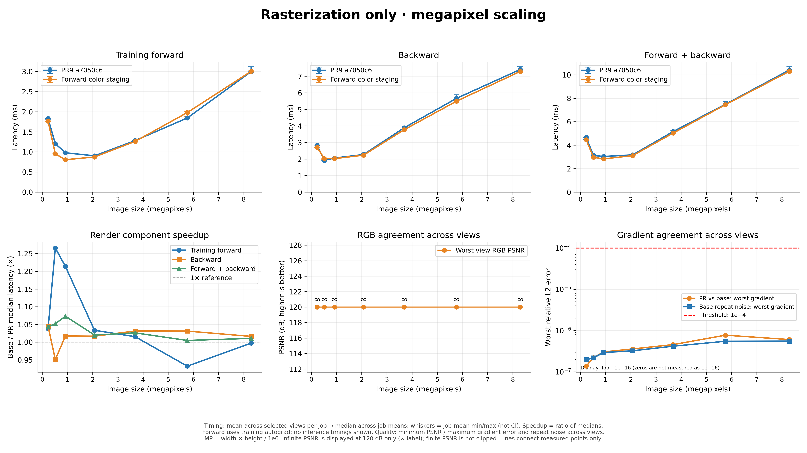

# Post-PR9 forward optimization: water2 evaluation

This is an independent follow-up to [PR9](https://github.com/jizongFox/gsplat/pull/9),
using its merged `dev/dc` commit `a7050c6` as the baseline. It is not a claim to
reproduce the CUDA blog's A100/9-scene headline.

## What changed

Each CUDA block owns a pixel tile and walks its front-to-back Gaussian list.
PR9 cooperatively stages Gaussian geometry (center, opacity, conic) in shared
memory, but each pixel that accepts a Gaussian then loads its color from global
memory. The same Gaussian color may be requested by many pixel lanes in one
tile batch.

For narrow renders (1–4 channels), this change stages each batch's colors in
shared memory alongside its geometry. Pixels reuse that tile-local color while
accumulating the unchanged `color * alpha * T` blend. Narrow forward can use the
batch lane as the color index, so it also omits the otherwise redundant staged
Gaussian ID. Wide-channel forward retains its original path.

```text
PR9:     tile list → shared geometry → pixel lanes → global color load per hit
This PR: tile list → shared geometry + color once → pixel lanes reuse shared color
```

At tile16, shared allocations are 7/8/9/10 KiB for 1/2/3/4 channels,
respectively (7 KiB for each with PR9). RGB/RGBA forward use 40 registers with
no spills. The arithmetic, alpha cutoff/clamp, pixel centers, exclusive
termination, binning order, precision, and public API are unchanged. This is a
data-reuse optimization, not a novel rendering algorithm. Fewer repeated global
color reads are the mechanism; no profiler-counter/occupancy study was done.

Only the forward optimization is retained. A separate backward tile-maximum
reduction experiment regressed and was reverted; no backward-kernel speedup is
claimed. The four PR9/backward source files were unchanged; all 19 backward
kernel SASS instruction hashes match the baseline.

## Workload and method

- GPU: NVIDIA RTX 4090, SM89; PyTorch 2.10.0+cu128, CUDA toolkit 12.8.
- Input: supplied water2 iteration-020000 PLY, all **1,932,132** degree-1 SH
  Gaussians. The COLMAP text export has 1,248 registered images and four PINHOLE
  cameras. We use image-ID-sorted indices **0, 623, 1247**, at native 1280×720.
- The adjacent `cameras.json` has different intrinsics/poses and 12 extra
  images. Benchmark cameras were generated from the supplied COLMAP text model
  using `../colmap_cameras.py`.
- Full differentiable-render and detached raster timings are separate. Settings
  follow PR9: RGB+ED, absgrad, compact-box sweep, tile16, unpacked, float32.
- Seven resolutions, 640×360 through 3840×2160; three serial alternating jobs
  per binary, 30 warmups and 80 timed samples. Table latency is the median of
  the per-job means, milliseconds. Forward is inference-only; combined is
  differentiable forward+backward. This is renderer timing, not optimizer/loss
  or whole-training iteration time.

## Results

| View | Scope | Forward baseline → candidate | Speedup | Forward+backward baseline → candidate | Speedup |
|---:|---|---:|---:|---:|---:|
| 0 | Raster | 0.388 → 0.397 ms | 0.976× | 1.266 → 1.269 ms | 0.997× |
| 623 | Raster | 0.563 → 0.559 ms | 1.006× | 1.836 → 1.834 ms | 1.001× |
| 1247 | Raster | 1.980 → 1.453 ms | **1.362×** | 6.012 → 5.387 ms | **1.116×** |
| 0 | Full | 1.626 → 1.521 ms | 1.069× | 4.668 → 4.524 ms | 1.032× |
| 623 | Full | 1.981 → 1.916 ms | 1.034× | 5.750 → 5.448 ms | 1.055× |
| 1247 | Full | 3.909 → 3.144 ms | **1.243×** | 10.151 → 9.573 ms | **1.060×** |

Native view1247 raster-forward ratios repeat across jobs: **1.370×, 1.359×,
1.364×**. Other raster views are approximately flat. Across 21 selected
view/resolution cases, geometric-mean speedups are 1.052× raster inference,
1.030× raster combined, 1.051× full inference, and 1.041× full combined.
Regressions exist: raster inference spans 0.956–1.362× and raster combined
0.972–1.143× (training-forward raster reaches 0.834×). This is workload-
dependent, not a universal speedup or a backward-kernel gain.



The plot/`overview.csv` average the three selected views; neither is an
all-1,248-view result. `delivery/timings.csv` retains the per-job means for all
252 workload rows. `quality.csv`, `gradients.csv`, and `parity_summary.json`
retain aggregate correctness details.

## Correctness and disclosures

- Gates unchanged: all-channel image/alpha max-absolute error ≤ **2e-5**;
  gradient relative-L2 ≤ **1e-4**.
- Delivery sweep: **42/42** forward cases and **231/231** gradient comparisons
  pass; images and alpha are bit-identical. Maximum relative-L2 is **7.72e-7**
  raster and **7.31e-5** full-render raw quaternion.
- Differential raster matrix: **174/174** pass on default and non-default
  streams. The original 166 PR9 fixtures/order/seeds are preserved; eight
  tile32 cases exercise staging across the 1024-splat batch boundary.
- Compute Sanitizer memcheck and synccheck: **zero errors**, all 174 fixtures.
- **106 CPU tests pass** across blog protocols/helpers/defaults and new camera /
  orchestration tests.
- `tests/test_rasterization.py` has **4 failures / 20 passes on both baseline
  and candidate** (degree-3 per-view-SH RGB/RGB+D reference mismatches, packed
  and unpacked). These inherited failures are not fixed or counted as passing.
- Two early exploratory candidate comparisons at view623/4K failed the
  quaternion gate (**1.14667e-4**, **1.15288e-4**). Two baseline-vs-baseline
  controls measured **3.03e-5** and **1.24005e-4**. These failures remain
  disclosed; the threshold is not relaxed and universal single-shot full-
  parameter equivalence is not claimed. Fresh delivery comparisons pass.
- The rejected backward experiment had geometric-mean speedups **0.975× full
  backward**, **0.968× raster backward**, and **0.982× / 0.989× combined**; it
  was removed rather than retained as a claimed improvement.
- No all-view/all-scene, other-GPU, training-convergence, optimizer-step,
  full-renderer stream-safety, or whole-renderer sanitizer claim is made.

## Reproduction

Use an existing compatible environment and external scene files; no PLY, PT
reference, or compiled extension is committed. Build baseline and candidate in
separate worktrees from the same environment (`CUDA_HOME=/usr/local/cuda-12.8`,
`TORCH_CUDA_ARCH_LIST=8.9`), then:

```bash
PY=/path/to/python
SCENE=/path/to/water2/outputs/56ee2948
"$PY" benchmarks/blog_eval/colmap_cameras.py \
  --sparse "$SCENE/exports/colmap/sparse" --output /tmp/water2-cameras.json

PYTHONPATH="$PWD" "$PY" benchmarks/blog_eval/run_followup.py \
  --baseline /path/to/a7050c6/csrc.so --candidate /path/to/candidate/csrc.so \
  --ply "$SCENE/point_cloud/iteration_020000/point_cloud.ply" \
  --cameras /tmp/water2-cameras.json --camera-indices 0 623 1247 \
  --jobs 3 --warmup 30 --repeats 80 \
  --reference-dir /tmp/water2-refs --output-dir /tmp/water2-results

"$PY" benchmarks/blog_eval/summarize_megapixels.py \
  --directory /tmp/water2-results --jobs 3
PYTHONPATH="$PWD" "$PY" -m pytest -q tests/test_blog*.py tests/test_defaults.py
```

The driver records parity failures and completes the timing jobs, then exits
unsuccessfully if any gate fails. A timing report alone is not a parity pass.
The retained binary hash is `5a0f78bb160523ba1eb0eee4a6150b0fbcf68f4b34e54bcc6b3cc385dfc71615`;
baseline hash is `c61a8253f35ebe5883ea6e67dd7f6e8de4cd2bd86b21eb931aad050b69efec06`.
