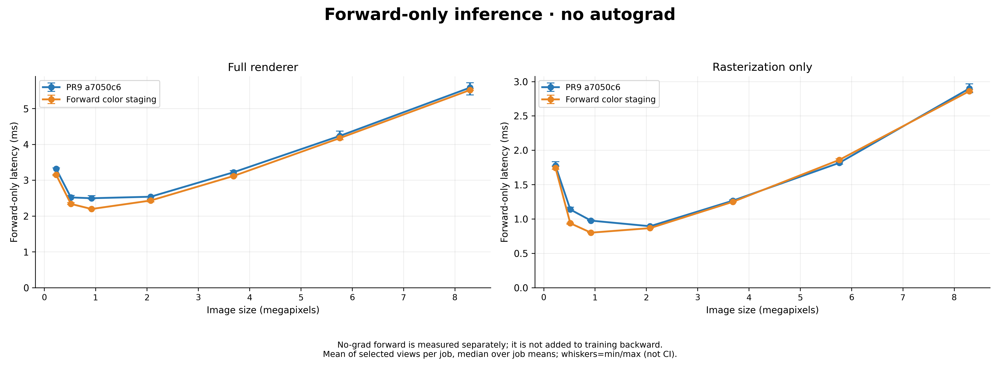

# Independent post-PR9 evaluation on water2

Baseline: `a7050c6`, the merge of PR9 into `dev/dc`. This is **not** another
comparison against PR9's older `ffe2db3` baseline. Article:
<https://grgkopanas.github.io/3dgs_cuda_blog/>.

## Inputs and scope

- Local NVIDIA RTX 4090 (SM89), existing PyTorch 2.10.0+cu128 environment,
  CUDA toolkit 12.8. No environment installation or parent-application changes.
- Supplied water2 iteration-020000 PLY: all **1,932,132** degree-1 SH Gaussians.
- Supplied `exports/colmap/sparse` text model: 1,248 registered images, four
  PINHOLE cameras, native resolution 1280×720. Select image-ID-sorted indices
  **0, 623, 1247** (first, middle, last), not PR9's different scene/view indices.
- Adjacent `cameras.json` is **not identical** to the supplied COLMAP model:
  intrinsics and poses differ, and it includes 12 additional images. We convert
  the actual COLMAP export using `colmap_cameras.py`; no calibration is fitted.
- Full differentiable renderer and detached raster workload are separate.
  Main sweep uses PR9's RGB+ED, absgrad, compact-box sweep, tile16, unpacked,
  float32 settings; seven resolutions from 640×360 through 3840×2160.
- These are renderer timings, **not** loss/optimizer/training iteration timings,
  ground-truth reconstruction quality, convergence evidence, or all-view means.

## Independent assessment of the article

| Article technique | Post-PR9 baseline / action in this follow-up |
|---|---|
| S01 compact-box/analytic row spans | Already available; hold settings fixed, do not count as a new gain. |
| S01 packed staging / cache reuse | Test cooperative staging of narrow forward colors into shared memory, without changing gsplat's public tensor layout. |
| S01 two-stage sorting / sub-tile masks | Not implemented here; neither performance nor parity claimed. Sorting tie order and auxiliary storage need separate validation. |
| S02 reduce-scatter | Already integrated by PR9. Two-splat folding remains unimplemented; paired RGB+ED/absgrad would require 24 components and more live state. |
| S03 SH streaming / zeroing | PR9's negative evidence remains relevant. No fresh gain claimed. BF16 storage is not a lossless substitution under these gates. |
| S04 backward pruning | PR9 already trims the occluded suffix. Independently test cheaper tile-maximum publication/reduction around that pruning. |
| S05 predication | PR9 already has hardened narrow-channel predication. Keep its nonfinite/clamp safeguards. |
| S06 multirow / pipe math | Not implemented or claimed; changes to recurrence arithmetic require their own gradient evaluation. |

This is a targeted systems integration study, not a claim to invent shared
memory staging, warp reductions, or the article's techniques. A100/9-scene
headline speedups cannot be transferred to this Ada/single-scene workload.

## Experiments and evidence

`screening/` retains exploratory native/4K reports. They are not pooled with
later alternating jobs. A color-only screen failed the unchanged raw-quaternion
gradient gate at view 623 / 4K (`rel_l2=1.14667e-4` versus `1e-4`). Images/alpha
were exact and screen-space gates passed. This failure is **not** relabelled as
a pass because atomic noise exists. The ID-eliding screen also failed that
same view/resolution (`1.15288e-4`); later references/passes do not erase either
failure. Both raw reports are retained.

Color-only native-resolution controls use three independent alternating jobs,
40 warmups and 100 timed iterations; compilation was concurrent CPU work, so
these controls are exploratory rather than the final clean-build timing study.
Forward raster speedup at view1247 repeats at about 1.35×; other views are
approximately flat, with small regressions. Unchanged backward timing moves
between jobs too: that movement is not a backward optimization gain.

The first backward experiment replaced shared atomics with a serial reduction
in thread0 but retained both barriers. The refined experiment publishes one
maximum per warp, has each warp reduce the published list, and relies on the
existing first-batch staging barrier before shared-memory reuse. Partial-warp
blocks retain PR9's path. Build/resource and timing evidence determine whether
either experiment is retained; removing an instruction is not itself a speedup.

**Both backward experiments are rejected.** In the full three-job,
seven-resolution combined sweep, the refined version's geometric mean of
per-view/resolution speedups was **0.975× full backward / 0.968× raster
backward**; combined speedups were **0.982× / 0.989×**, respectively. All 42
parity cases passed, but that does not justify retaining a slower kernel.
RGB register allocation also rose from 48 to 64 (RGBA stayed 56). See
`rejected_combined/` and `builds/resources-tail-publish.txt`.

The retained candidate is **forward-only**, with PR9 backward source restored.
All **19 backward kernel SASS instruction hashes match baseline**, recorded in
`builds/backward_sass_identity.json`; timing movement in backward is not claimed
as a new backward-kernel optimization.

Its narrow-channel shared layout stages colors instead of repeatedly reading
them per active pixel, and omits Gaussian IDs that narrow forward no longer
uses. The shared-memory budget at tile16 is:

| Channels | PR9 | First color-staging experiment | ID-eliding candidate |
|---|---:|---:|---:|
| 1 | 7 KiB | 8 KiB | 7 KiB |
| 2 | 7 KiB | 9 KiB | 8 KiB |
| 3 | 7 KiB | 10 KiB | 9 KiB |
| 4 | 7 KiB | 11 KiB | 10 KiB |

RGB/RGBA forward retain **40 registers and zero spills**. Wide-channel forward
keeps its old layout and global color path. No arithmetic, alpha cutoff/clamp,
pixel-center, exclusive-termination, binning order, precision, or API changes
are intended. Reduced shared-memory pressure is a mechanism hypothesis, not a
measured occupancy or profiler-counter claim.
No additional timing gain is attributed separately to ID elision versus the
first staged-color variant; its verified benefit is the smaller shared layout.

## Delivery timing results

`delivery/` is the **retained binary**, SHA-256
`5a0f78bb160523ba1eb0eee4a6150b0fbcf68f4b34e54bcc6b3cc385dfc71615`.
Baseline SHA-256:
`c61a8253f35ebe5883ea6e67dd7f6e8de4cd2bd86b21eb931aad050b69efec06`.
Build commands, source hashes, experimental patches and resource reports are
under `builds/`. The delivery uses a normal setuptools rebuild after reverting
backward, with unchanged objects cached from the earlier full worktree build.

Three independent serial jobs per binary, alternating **base/pr, pr/base,
base/pr**; 30 warmups and 80 timed samples per workload. No compilation or
other GPU experiment ran concurrently with delivery timing. Each table latency
is the **median of three job means**, in milliseconds. Forward below means
inference-only; combined means differentiable forward+backward. Training
forward, backward, every sample and job order/telemetry remain in the raw JSON.

| Camera index | Scope | Forward base → delivery | Forward speedup | Combined base → delivery | Combined speedup |
|---:|---|---:|---:|---:|---:|
| 0 | raster | 0.388 → 0.397 | 0.976× | 1.266 → 1.269 | 0.997× |
| 623 | raster | 0.563 → 0.559 | 1.006× | 1.836 → 1.834 | 1.001× |
| 1247 | raster | 1.980 → 1.453 | **1.362×** | 6.012 → 5.387 | **1.116×** |
| 0 | full | 1.626 → 1.521 | 1.069× | 4.667 → 4.524 | 1.032× |
| 623 | full | 1.981 → 1.916 | 1.034× | 5.750 → 5.448 | 1.055× |
| 1247 | full | 3.909 → 3.144 | **1.243×** | 10.151 → 9.573 | **1.060×** |

The native view1247 raster-forward pair ratios are **1.370×, 1.359×, 1.364×**;
combined ratios are **1.116×, 1.150×, 1.069×**. This repeatable overdraw-heavy
benefit is the main reason to retain the forward change, not small movements
in unmodified stages.

Across the **21 selected view/resolution cases** (not an all-view/all-scene
average), geometric means of individual case speedups are 1.052× raster
inference / 1.030× raster combined, and 1.051× full inference / 1.041× full
combined. There are regressions: case ranges are 0.956–1.362× raster inference
and 0.972–1.143× raster combined; training-forward raster ranges as low as
0.834×. Small whole-renderer movements and backward changes are noisy and must
not be interpreted as universal or backward-kernel gains. No clock locking or
profiler-counter/occupancy study was performed.




The PR9 plotter averages the **three selected views** before aggregating jobs;
the native table above is per-view. `overview.csv` uses that three-view-average
convention too; neither is an average over all 1,248 images. `timings.csv`
retains all 252 individual job/workload rows for alternative aggregation.

## Correctness and limitations

- Unchanged gates: image/all-channel/alpha max-abs ≤ **2e-5**, every gradient
  relative-L2 ≤ **1e-4**, no threshold relaxation, quantization or gradient
  subsampling.
- Delivery sweep: **42/42** forward and gradient cases pass; images/alpha are
  bit-identical, all **231/231** gradient comparisons pass. Maximum relative-L2
  is **7.72e-7 raster** and **7.31e-5 full raw quaternion**. References cover all
  values using PR9's lossless zero-row representation.
- The two exploratory 4K quaternion failures remain failures, even though the
  fresh delivery-reference comparison passes. This is **not** a claim of
  universal single-pass full-parameter equivalence.
- Two predeclared independent **baseline-versus-baseline** cross-process
  controls against the original view623/4K reference give quaternion relative-L2
  **3.03e-5 (pass)** and **1.24005e-4 (fail)**. This confirms baseline variability
  can exceed the gate; it does not relax that gate or excuse candidate failures.
- Supplementary native-resolution **RGB without absgrad** comparisons pass for
  all three views in both scopes: maximum gradient relative-L2 **1.30e-5 full**
  and **4.34e-7 raster**. These single-job checks support parity, not a repeated
  RGB timing/speedup claim.
- **174/174** differential raster fixtures pass on both default and non-default
  streams. All 166 PR9 configurations/order/seeds are preserved (CPU hash guard),
  with eight appended tile32 cases. New cases assert that color gradients do,
  or do not, extend past the 1024-splat staging boundary as intended.
- Compute Sanitizer **memcheck and synccheck: zero errors** over all 174 cases.
  Standalone reduce-scatter contract dimensions 1–16 pass, including memcheck.
- **106 CPU tests pass** for reference protocols, preflight, defaults, camera
  conversion, serial orchestration and unchanged fixture identity.
- Broader `tests/test_rasterization.py`: **20 pass / 4 fail on delivery and
  baseline alike**. The four degree-3 per-view-SH reference mismatches affect
  RGB/RGB+D in packed and unpacked modes. They are not fixed or counted as
  passing by this PR. Logs are retained under `validation/`.
- Full-renderer non-default-stream safety, sanitizer coverage of the whole
  renderer, training convergence, optimizer steps, and generalization to
  other scenes/GPUs are not established by these checks.

## Reproduction

Use the existing environment; do not install this worktree into it or modify
the original source checkout. Large PLY/PT references and compiled binaries are
external inputs/artifacts, not committed files.

```bash
PY=/home/jizong/workspace/dConstruct/gaussian-splatting/venv/bin/python
SCENE=/home/jizong/workspace/dConstruct/data/2026-10-10-water2/outputs/56ee2948

# Build a7050c6 in a separate baseline worktree, and this PR in its own
# worktree, using the same settings (set each build output path explicitly).
CUDA_HOME=/usr/local/cuda-12.8 TORCH_CUDA_ARCH_LIST=8.9 MAX_JOBS=4 \
  "$PY" setup.py build_ext --build-lib build/delivery --build-temp build/objects

"$PY" benchmarks/blog_eval/colmap_cameras.py \
  --sparse "$SCENE/exports/colmap/sparse" \
  --output /tmp/opencode/water2-colmap-cameras.json

PYTHONPATH="$PWD" PYTHONDONTWRITEBYTECODE=1 \
"$PY" benchmarks/blog_eval/run_followup.py \
  --baseline /path/to/a7050c6/csrc.so \
  --candidate "$PWD/build/delivery/gsplat/csrc.so" \
  --ply "$SCENE/point_cloud/iteration_020000/point_cloud.ply" \
  --cameras /tmp/opencode/water2-colmap-cameras.json \
  --camera-indices 0 623 1247 --jobs 3 --warmup 30 --repeats 80 \
  --reference-dir /tmp/opencode/water2-new-refs \
  --output-dir /tmp/opencode/water2-new-results

"$PY" benchmarks/blog_eval/summarize_megapixels.py \
  --directory /tmp/opencode/water2-new-results --jobs 3

PYTHONPATH="$PWD" "$PY" -m pytest -q tests/test_blog*.py tests/test_defaults.py

BASE=/path/to/a7050c6/csrc.so
PR="$PWD/build/delivery/gsplat/csrc.so"
REF=/tmp/opencode/water2-raster-new.pt
export PYTHONPATH="$PWD" PYTHONDONTWRITEBYTECODE=1
"$PY" benchmarks/blog_eval/gsplat_raster_regression.py \
  --extension "$BASE" --save "$REF"
"$PY" benchmarks/blog_eval/gsplat_raster_regression.py \
  --extension "$PR" --compare "$REF"
"$PY" benchmarks/blog_eval/gsplat_raster_regression.py \
  --extension "$PR" --compare "$REF" --nondefault-stream
for TOOL in memcheck synccheck; do
  /usr/local/cuda-12.8/bin/compute-sanitizer --tool "$TOOL" \
    --target-processes all --error-exitcode 99 \
    "$PY" benchmarks/blog_eval/gsplat_raster_regression.py \
    --extension "$PR" --compare "$REF"
done
```

The serial driver finishes timing jobs even when parity fails, records failures
in its manifest, and then exits unsuccessfully; **a report file or timing is
not evidence that parity passed**. Raw job labels/source revisions are runtime
provenance, not proof of compilation inputs; binary/source manifests provide
that additional identity. Copied exploratory reports use `base`/`pr` filenames
for compatibility with the unchanged PR9 summarizer; manifest command paths
retain their actual original local names.
