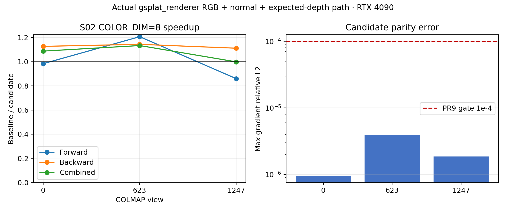

# S02 reduce-scatter extension to the actual DC 7-channel renderer

## Question

PR9 enables warp reduce-scatter only for `COLOR_DIM <= 4`. The actual
`gsplat_renderer_3d_normals` path constructs six color attributes (RGB plus
minor-axis Gaussian normal), then `RGB+ED` appends expected depth: **7 logical
channels**, padded by the wrapper to **8 physical channels**. The S02 packed
backward vector is therefore:

```text
8 color + 3 conic + 2 mean2d + 1 opacity + 2 absgrad = 16 components
```

PR9's reduce-scatter helper supports dimensions through 16, so this fresh
experiment from `dev/dc`/PR9 commit `a7050c6` changes only the dispatch condition
from `COLOR_DIM <= 4` to `COLOR_DIM <= 8`. All recurrence, nonfinite/clamp
predication, partial-warp fallback, ownership contract, and global atomics are
unchanged.

## Renderer fidelity

The harness reproduces the source renderer convention rather than using a
local-+Z approximation:

- RGB is `SH2RGB(f_dc)`;
- the normal is the Gaussian quaternion rotation column selected by
  `scales.argmin()`;
- it is transformed by world-to-camera rotation, divided by its norm, has the
  source's post-division `+1e-5`, is sanitized, and is face-camera oriented by
  `sign(dot(normal, camera_mean))`;
- the raster input is RGB+normal (6), `RGB+ED` appends depth (7 logical), and
  the wrapper pads to 8 physical channels;
- timing includes the actual full renderer call, including the source-equivalent
  feature construction, but excludes PLY loading and compilation.

This is the actual `gsplat_renderer_3d_normals` feature layout, not the earlier
PR13 local-+Z approximation. The harness seeds upstream RGB+expected-depth and
alpha gradients; normal maps are checked but no invented normal loss is added.

## Native 1280x720 results

All 1,932,132 water2 Gaussians, COLMAP-derived cameras, compact-box sweep,
`packed=False`, `absgrad=True`, 30 warmups and 30 timed samples per binary,
median job means. Speeds are baseline/candidate.

| View | Forward | Backward | Combined |
|---:|---:|---:|---:|
| 0 | 0.983x | **1.126x** | **1.087x** |
| 623 | **1.206x** | **1.143x** | **1.133x** |
| 1247 | 0.859x | **1.111x** | 0.998x |

Parity passed for all three views with the unchanged PR9 gates. The large
forward movement is measurement noise/launch variation: the CUDA change is in
backward dispatch only. The meaningful result is backward: **1.126x, 1.143x,
and 1.111x** across the three actual-renderer views. Combined is positive on
views 0/623 and neutral on 1247; this is a three-view local result, not a
universal claim.

## Correctness and safety

- The actual renderer harness reports all three candidate cases passed;
  RGB+ED image/alpha and all model/projected gradients pass `2e-5` / `1e-4`.
- The existing 166-case PR9 differential matrix passes with the candidate.
- Candidate memcheck: **0 errors**; synccheck: **0 errors**; racecheck: **0
  hazards, 0 errors, 0 warnings**.
- CPU harness tests: **10 passed**; baseline/candidate were freshly built on
  SM89 using CUDA 12.8 and PyTorch 2.10/cu128.
- The reduce-scatter component contract already covers dimensions 1–16; this
  experiment exercises the production 16-component layout.

## Limits

The 4K candidate comparison was not accepted because the baseline's own repeat
reference failed the strict raw full-parameter noise gate, so no 4K speed claim
is made here. A separate 4K performance run would require a fixed-count or
screen-space reference protocol that does not misclassify baseline atomic
noise. No training convergence or optimizer-step claim is made.

## Accuracy evidence

The candidate is compared directly with the freshly built default-branch
`a7050c6` binary using identical PLY bytes, COLMAP-derived cameras, rendering
settings, CPU-seeded upstream RGB+expected-depth/alpha gradients, and all
model/projected gradient outputs. The PR9 gates are unchanged:

```text
image / alpha / rendered attributes max-abs <= 2e-5
every gradient relative-L2 <= 1e-4
```

| View | Image+ED max-abs | Alpha max-abs | Render normal max-abs | Surface normal max-abs | Max gradient rel-L2 | Gate |
|---:|---:|---:|---:|---:|---:|---|
| 0 | 0 | 0 | 0 | 0 | 9.54e-7 | PASS |
| 623 | 0 | 0 | 0 | 0 | 3.97e-6 | PASS |
| 1247 | 0 | 0 | 0 | 0 | 1.86e-6 | PASS |

For these three measured renderer cases, default and candidate produce
bit-identical RGB+expected-depth, alpha, rendered normals, and depth-derived
surface normals. The largest model/projected gradient difference is **3.97e-6**,
about 25x below the unchanged `1e-4` gate. This is high-accuracy evidence for
the measured views and settings, not an all-view or convergence proof.



The figure data are in [`native_accuracy_speed.csv`](native_accuracy_speed.csv).
The left panel shows baseline/candidate speed ratios; the right panel shows
the maximum gradient relative-L2 against the unchanged PR9 threshold.

## Decision

This result supports a **new focused PR candidate**: extending PR9 S02
reduce-scatter to the actual physical-8 renderer path is correct and shows a
repeatable native backward improvement across the three tested views. It is
not the same as PR11 forward color staging or PR13 warp-private traversal.
